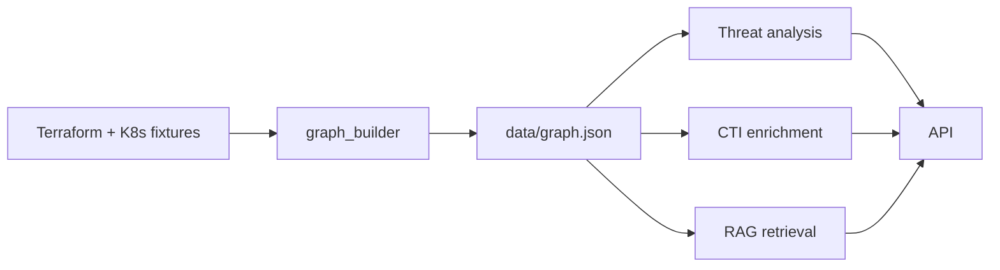

# ArgusLoom

ArgusLoom é um MVP de análise de risco e modelação de ameaças sobre grafos de infraestrutura, com ingestão de Terraform e Kubernetes, enriquecimento CTI e recuperação semântica por embeddings.

## Quickstart

```bash
pip install -e ".[dev]"
cp .env.example .env
argusloom demo
argusloom serve  # ou: argusloom export-openapi
```

## Arquitetura

A arquitetura detalhada está em [docs/architecture.md](docs/architecture.md).



## Endpoints

| Método | Path | Descrição |
|---|---|---|
| GET | `/health` | Estado de saúde do serviço |
| GET | `/` | Metadados do serviço |
| POST | `/graph/analyze` | Analisa risco do grafo recebido |
| POST | `/graph/remediation` | Produz plano de remediação |
| GET | `/nodes/{id}/blast-radius` | Calcula blast radius a partir do nó |
| POST | `/attack-paths` | Explora caminhos de ataque |
| POST | `/rag/query` | Recuperação semântica por embeddings |
| POST | `/cti/enrich` | Enriquece o grafo com MITRE e CVEs |

## Mockabilidade

A documentação de mockabilidade está em [docs/mockability.md](docs/mockability.md). O projeto usa LLM e NVD mock por default para demos offline e reprodutibilidade, mantendo a opção real disponível sem quebrar o contrato do grafo.

## Testes

```bash
pytest -q
ruff check src/argusloom/cli.py tests/unit/test_cli_demo.py tests/unit/test_cli_export.py tests/integration/test_end_to_end.py
black --check src/argusloom/cli.py tests/unit/test_cli_demo.py tests/unit/test_cli_export.py tests/integration/test_end_to_end.py
```

> Dívida técnica remanescente: `ruff`/`black` ainda não são completamente limpos em módulos legados (`analysis/`, `ingestion/`, testes F2–F5), e os endpoints antigos continuam como `dict[str, Any]` por decisão de retrofit adiado.

## Estrutura do repositório

```text
src/argusloom/
  api/
  analysis/
  cti/
  domain/
  graph/
  ingestion/
  rag/
  workflow/
  cli.py

tests/
  integration/
  unit/
```

## Limitações e trabalho futuro

- Frontend em Cytoscape.js não foi incluído no MVP.
- Retrofit de Pydantic nos endpoints antigos ficou fora do escopo da fase atual.
- Multi-cloud, autenticação, e integração com produção real mais extensa não fazem parte do MVP.
- CTI real em produção e orquestração mais robusta ficam como extensão natural após a tese e a defesa.

## Referências

### Obrigatórias
- Requisitos do projeto e critérios do MVP (documento de requisitos do projeto, consultado na fase de análise).
- Documentação de migração e modelação de ameaças para grafos de infraestrutura.
- Regras de validação e critérios de entrega deste projeto final de Licenciatura.

### Sugestidas
- MITRE ATT&CK framework e ATLAS.
- NVD CVE database e scoring CVSS.
- Estruturas de retrieval por embeddings e ChromaDB.

## Licença

Este projeto está disponível sob a licença MIT, em linha com a convenção do repositório e com o uso académico do MVP.
