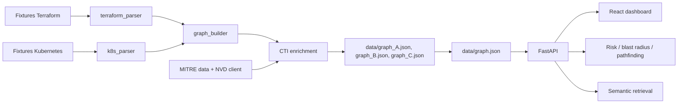

# Arquitetura do ArgusLoom

## Visão geral

O repositório contém um backend Python com API FastAPI e um frontend React/Vite independente. O backend parte de fixtures Terraform e Kubernetes, constrói grafos serializados em JSON, e serve o grafo ativo e operações de análise. O frontend consulta a API e oferece uma vista geral, exploração em modo de grafo ou lista, detalhe de nó, blast radius e caminhos de ataque.

`data/graph.json` é o grafo ativo lido por `/graph`, blast radius e caminhos de ataque. A CLI `argusloom scenario A|B|C` copia o grafo de cenário selecionado para esse caminho. `argusloom demo` pode gerar o grafo base novamente a partir das fixtures de raiz.

## Módulos do backend

| Área | Módulo | Responsabilidade implementada |
|---|---|---|
| API | `src/argusloom/api/app.py` | Cria a aplicação FastAPI, configura CORS, carrega o grafo ativo e declara endpoints de grafo e análise |
| API | `src/argusloom/api/routes/analysis.py` | Modelos Pydantic para pedidos e respostas de blast radius e caminhos |
| API | `src/argusloom/api/routes/cti.py` | Endpoint de enriquecimento CTI |
| API | `src/argusloom/api/routes/rag.py` | Pesquisa semântica sobre o grafo e resposta LLM opcional |
| API | `src/argusloom/api/routes/scenarios.py` | Lista, identifica e ativa cenários quando `dev_mode` está ligado |
| Ingestão | `src/argusloom/ingestion/terraform_parser.py` | Converte recursos e referências Terraform suportados em nós e arestas |
| Ingestão | `src/argusloom/ingestion/k8s_parser.py` | Converte manifests Kubernetes suportados em nós e arestas |
| Ingestão | `src/argusloom/ingestion/graph_builder.py` | Combina os resultados dos parsers e pode persistir o grafo |
| Persistência | `src/argusloom/graph/store.py` | Serializa e carrega o modelo de grafo JSON |
| Análise | `src/argusloom/analysis/threat_model.py` | Calcula findings e pontuações locais por nó |
| Análise | `src/argusloom/graph/blast_radius.py` | Calcula nós e arestas alcançáveis a partir de um nó raiz |
| Análise | `src/argusloom/graph/pathfinding.py` | Calcula caminhos de ataque com Dijkstra ou Yen |
| CTI | `src/argusloom/cti/mitre_loader.py` | Carrega dados MITRE ATT&CK e ATLAS locais |
| CTI | `src/argusloom/cti/nvd_client.py` e `src/argusloom/cti/enrich.py` | Obtém/adapta dados de CVE e enriquece os nós |
| RAG | `src/argusloom/rag/embeddings.py`, `retriever.py`, `vector_store.py` | Produz embeddings, indexa o grafo e recupera hits semânticos |
| Workflow | `src/argusloom/workflow/remediation.py` | Cria um plano de remediação a partir do grafo |
| CLI | `src/argusloom/cli.py` | Expõe demo, servidor, seleção de cenários e exportação OpenAPI |

## Fluxos principais

### Ingestão e seleção de cenário

`ingest.py` constrói grafos de cenários A, B ou C a partir das respetivas fixtures e grava os JSON de cenário em `data/`. A ativação por CLI ou pelo endpoint de desenvolvimento copia o JSON escolhido para `data/graph.json`; o frontend não altera diretamente o grafo persistido.

### Análise e visualização

O frontend obtém o grafo ativo através de `GET /graph`. A análise de risco e o plano de remediação recebem um grafo no corpo do pedido. Blast radius e caminhos de ataque analisam o grafo persistido, identificando nós através dos seus IDs.

O explorador permite alternar entre canvas Cytoscape e tabela HTML. A tabela serve de alternativa navegável por teclado ao canvas; a seleção de uma linha atualiza o painel de detalhe.

### Recuperação semântica

`POST /rag/query` carrega o grafo ativo, reinicia a coleção Chroma com o nome `argusloom-rag`, cria o embedding e indexa novamente o grafo antes de consultar os hits. A geração de `llm_answer` só é tentada quando `include_llm_answer` é verdadeiro; é falso por omissão e o frontend pede apenas os hits. Este fluxo não percorre arestas nem calcula blast radius ou caminhos.

### Caminhos de ataque

- `dijkstra`: devolve um único caminho de custo mínimo; `top_k` é ignorado.
- `yen`: devolve até `top_k` caminhos simples estruturalmente distintos, ordenados por custo.
- A interface permite configurar `top_k` para Yen e representa um único melhor caminho para Dijkstra.

## Componentes externos e fronteiras

- Os datasets MITRE ATT&CK e ATLAS são carregados de ficheiros locais em `data/mitre/`.
- O NVD tem adapters mock e real; o mock é o default de configuração.
- O embedding usa `sentence-transformers` e o armazenamento vetorial usa ChromaDB.
- O adapter LLM mock está disponível. O `OpenAIProvider` existe como classe de interface, mas está intencionalmente indisponível e lança `NotImplementedError` após a verificação de dependência.
- Os endpoints de ativação de cenários são de desenvolvimento e dependem da configuração `dev_mode`.

## Limites documentados pelo comportamento atual

O sistema processa os tipos de recurso explicitamente suportados nos parsers e os dados presentes nas fixtures; não pretende cobrir todas as construções Terraform ou Kubernetes. A análise de risco é heurística. Os ficheiros JSON do grafo são a persistência utilizada nesta configuração, não uma base de dados relacional.
