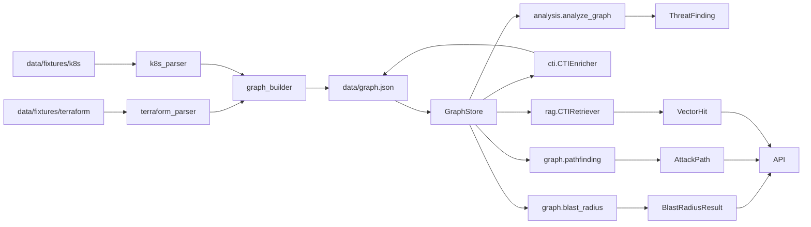

# Arquitetura do ArgusLoom

## Fluxo de dados

## Módulos

| Módulo | Responsabilidade | Entrada | Saída |
|---|---|---|---|
| `ingestion.terraform_parser` | Lê ficheiros Terraform e converte recursos em nós/arestas | diretório `data/fixtures/terraform` | `GraphNode`/`GraphEdge` |
| `ingestion.k8s_parser` | Lê manifests Kubernetes e modela workloads e serviços | diretório `data/fixtures/k8s` | `GraphNode`/`GraphEdge` |
| `ingestion.graph_builder` | Agrega recursos Terraform + Kubernetes | caminhos das fixtures | `Graph` |
| `graph.store.GraphStore` | Persiste/recupera o grafo em JSON | `data/graph.json` | `Graph` |
| `analysis.threat_model` | Calcula risco por nó e prioriza ameaças | `Graph` | `ThreatFinding[]` |
| `graph.blast_radius` | Mede blast radius a partir de um nó raiz | `Graph`, findings, nó alvo | `BlastRadiusResult` |
| `graph.pathfinding` | Explora caminhos de ataque | `Graph`, source, target | `AttackPath[]` |
| `cti.mitre_loader` | Carrega técnicas ATT&CK/ATLAS locais | ficheiros JSON | `MITRETechnique[]` |
| `cti.nvd_client` | Consulta CVEs em modo mock ou real | palavra-chave | `CVE[]` |
| `cti.enrich` | Enriquece cada nó com CVEs e técnicas MITRE | `Graph` + CTI | `Graph` enriquecido |
| `rag.retriever` | Indexa e consulta embeddings por semântica | grafos + queries | `VectorHit[]` |
| `api.app` | Expõe endpoints REST e serialização | solicitações HTTP | JSON/Pydantic |

## Decisões arquiteturais

- Dataclasses (não Pydantic) no domínio — rationale: leveza, sem validação runtime, serialização controlada.
- `GraphStore` com persistência JSON — rationale: simplicidade, git-friendly, adequado para grafos pequenos.
- RAG por embeddings + Chroma — rationale: requisito do projeto, `sentence-transformers` local evita dependência de API.
- CTI mock por default, real disponível — rationale: demo offline, reprodutibilidade.
- Endpoints antigos em `dict`, novos em Pydantic — rationale: retrofit adiado (dívida documentada).

## Fluxo de dados

A ingestão começa nos JSON/YAML das fixtures, sendo normalizada em nós e arestas por parsers específicos para Terraform e Kubernetes. O `graph_builder` combina os resultados num único `Graph` e a serialização em `data/graph.json` oferece um checkpoint simples e reprodutível para testes, API e demos. Esta persistência reduz dependências do ambiente e permite que a análise e o enriquecimento CTI se executem em pipeline determinístico.

A análise de risco usa a estrutura do grafo para atribuir scores por nó e inferir ameaças com base em `kind`, `criticality`, `exposure` e `stride`. O enriquecimento CTI adiciona técnicas MITRE e CVEs do fornecedor mock por default, com opção de integrar uma fonte real sem alterar a arquitetura do grafo. O mesmo grafo serve também a blast radius, pathfinding e a camada RAG, que indexa documentos com embeddings locais para recuperação semântica.

Os endpoints REST consumem este grafo persistido e devolvem resultados estruturados para a UI ou para ferramentas de demonstração. O desenho mantém a camada de domínio leve e o pipeline de negócio explícito, favorecendo depuração simples e reprodução na dissertação. Fica fora do escopo a reengenharia do contrato HTTP legado, que foi mantido como dívida técnica consciente.

## Fora de âmbito

Ficou fora do MVP final a camada frontend em Cytoscape.js, a autenticação e autorização, a integração multi-cloud, GRPO ou fine-tuning de LLMs, e as otimizações de produção para CTI em tempo real. O foco foi fechar uma prova de conceito funcional, reproduzível e documentada, pronta para defesa e para extensão futura.
